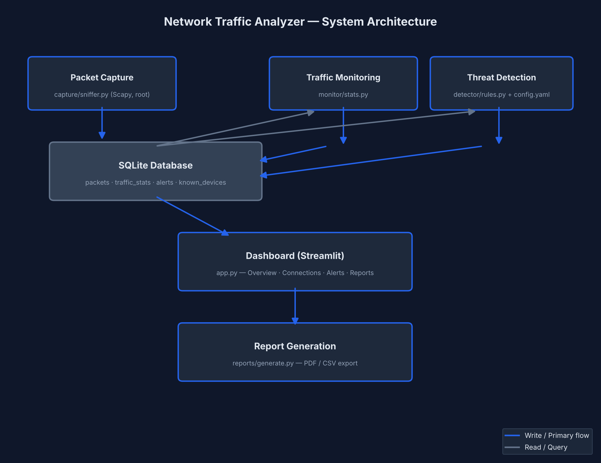

# Network Traffic Analyzer

A Python-based network traffic monitoring and security analysis tool. Captures live packets, computes real-time traffic statistics, detects suspicious activity using configurable rules, and presents everything through an interactive dashboard with exportable reports.

## Features

- Live packet capture using Scapy (IP, protocol, ports, size, timestamp)
- Real-time traffic monitoring -- bandwidth, active connections, protocol distribution
- Rule-based suspicious activity detection:
  - Traffic spikes
  - Unknown/non-private IP activity
  - Repeated connection attempts
  - Port scan patterns
- Interactive Streamlit dashboard with live-updating charts and alerts
- Exportable reports -- CSV traffic summaries, CSV alert logs, and formatted PDF security reports
- Configurable detection thresholds via detector/config.yaml

## Architecture

sniffer.py (Scapy, root) -> SQLite -> stats.py (aggregation) -> rules.py (detection) -> alerts -> dashboard/app.py (Streamlit) -> reports/generate.py (PDF export)

See docs/architecture.md for the full design: data flow, DB schema, and detection logic.

## Project Structure

capture/      Packet capture (sniffer.py)
monitor/      Traffic statistics aggregation (stats.py)
detector/     Suspicious activity detection (rules.py, config.yaml)
dashboard/    Streamlit UI (app.py)
reports/      PDF/CSV report generation (generate.py)
db/           SQLite schema and database
tests/        Automated test suite (pytest)
docs/         Architecture notes and screenshots

## Requirements

- Python 3.9+ (tested on 3.13)
- Linux environment with raw socket access (tested on Kali via WSL2)
- Root/sudo privileges for packet capture

## Setup

git clone <repo-url>
cd network-traffic-analyzer
python3 -m venv venv
source venv/bin/activate
pip install -r requirements.txt
sqlite3 db/traffic.db < db/schema.sql

## Running

Each component runs independently (separate terminals):

Terminal 1 -- packet capture (needs root):
sudo venv/bin/python3 capture/sniffer.py

Terminal 2 -- traffic stats aggregation:
python3 monitor/stats.py --interval 5

Terminal 3 -- suspicious activity detection:
python3 detector/rules.py --interval 5

Terminal 4 -- dashboard:
streamlit run dashboard/app.py

Open the dashboard at http://localhost:8501

## Testing

pytest tests/ -v

12 automated tests covering detection rule logic and packet parsing.

## Configuration

Detection thresholds are set in detector/config.yaml -- adjust pps_threshold, attempt_threshold, distinct_port_threshold, and trusted IP ranges as needed for your environment.

## Scope and Limitations

This tool is built for monitoring and analyzing traffic on networks/hosts you own or are authorized to test. It performs no offensive actions, unauthorized scanning, or exploitation -- detection is entirely passive and rule-based.

## Screenshots

See docs/screenshots/ for dashboard views, live detection output, and sample reports.
